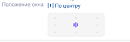
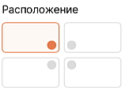
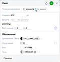
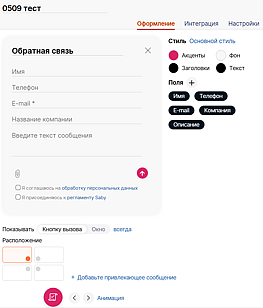
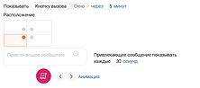
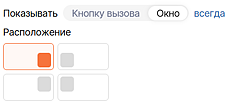
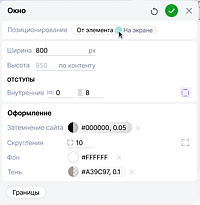
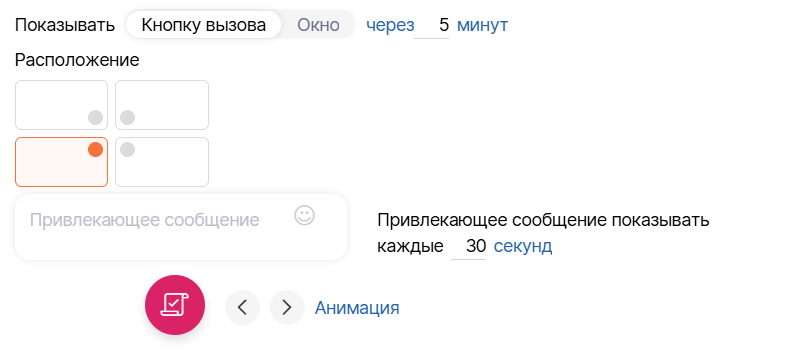

Каталог/Окна/Внешние виджеты

================================

Концептуальное описание
-----------------------

При добавлении внешних виджетов, каталога и корзины из магазина конструктор автоматически создаёт окна.

У страницы появляется настройка "тип открытия":

*   Страница: открывается как самостоятельная страница сайта
    
*   Окно: открывается поверх текущей страницы
    
*   Страница и окно: по прямой ссылке открывается страница, по действию на сайте - окно без изменения URL
    

Базово настройки окна содержат два редактора положения:

*   Свободное (редактор 1) - окно располагается относительно границ экрана. Положение задаётся стандартным редактором.
    
*   Привязанное к элементу (редактор 2) - окно располагается относительно элемента, из которого было открыто. Доступны четыре типовых положения и настройка отступов (например, для задачи совмещения вызывающей кнопки и кнопки в окне как у корзины). По умолчанию окно прилегает к границе элемента.
    

*   размер, отступы, оформление, границы
    

### 1\. Внешние виджеты

Все типы внешних виджетов доступны в магазине конструктора.

При добавлении пользователь выбирает тип виджета, затем нужный экземпляр (если есть несколько).

Появляется окно выбора:

*   вставить окно - внешний виджет вставляется в соответствии со своими настройками в админке + создается окно (страница с доступным режимом открытия "окно")
    
*   вставить контент - внешний виджет вставляется в секцию как часть контента страницы
    

По клику по настройкам в тулбаре виджета поднимается панель настройки виджета, аналогичная админке.

Предусмотрено три сценария размещения внешних виджетов.

1\. Внешний виджет с плавающей кнопкой (плавающим окном)

1.  Пользователь выбирает внешний виджет из магазина
    
2.  В появившемся поле выбора нажимает вставить окно
    
3.  На сайте появляется плавающая кнопка/плавающее окно, с списке страниц автоматически создаётся окно с содержимым виджета
    
4.  Из тулбара виджета можно перейти к настройкам интеграции (поменять кнопку на окно и выбрать положение). Изменения синхронизируются с админкой
    

настройки интеграции

5.  В настройки окна подтягиваются настройки положения, выбранные в админке. Доступен только один из редакторов положения:
    
    1.  если настроена вставка плавающей кнопки - [редактор 2](https://online.sbis.ru/shared/disk/c6d3c7c2-8037-49c9-8732-ff9afa4295d1#d397bf10-4a4f-45dc-b3d5-0e07af4ff489)
        
    2.  если настроена вставка окна - [редактор 1](https://online.sbis.ru/shared/disk/c6d3c7c2-8037-49c9-8732-ff9afa4295d1#dab6d611-6bfa-4837-8011-c624ae6ff51f)
        
6.  Изменить тип плавающая кнопка/окно можно через панель настроек внешнего виджета (тогда автоматически поменяется редактор)
    

2\. Открыть добавленный внешний виджет по клику на другой элемент

1.  Пользователь добавляет внешний виджет как в сценарии 1
    
2.  Пользователь выбирает нужный элемент сайта и через действие «Открыть страницу сайта» привязывает к нему созданное окно
    
3.  При нажатии на элемент открывается окно внешнего виджета
    
4.  Способ открытия соответствует настройкам в админке
    

3\. Внешний виджет в теле страницы

1.  Пользователь выбирает внешний виджет из магазина
    
2.  В появившемся поле выбора нажимает вставить контент
    
3.  Виджет добавляется непосредственно в секцию или другой контейнер. Окно не создаётся
    
4.  Из тулбара виджета доступна панель настройки, аналогичная админке
    

настройки интеграции, должна появиться кнопка "секция"

### 2\. Каталог

1.  Пользователь добавляет каталог из магазина виджетов
    
2.  Каталог включает свой компонент (см. [5. Компоненты](#5-компоненты)), компонент приносит страницу карточки товара с типом открытия "страница и окно"
    
3.  При переходе к товару из каталога карточка открывается в окне поверх текущей страницы. По прямой ссылке - как самостоятельная страница
    
4.  Карточку товара можно редактировать в конструкторе в режимах страницы и окна
    
5.  При удалении каталога карточка товара остаётся: она принадлежит компоненту и удаляется только вместе с ним
    

### 3\. Корзина

1.  Пользователь добавляет корзину из магазина виджетов
    
2.  Корзина включает свой компонент, компонент приносит страницу корзины с типом открытия "страница и окно"
    
3.  При открытии корзины с сайта она отображается в окне. По прямой ссылке - как самостоятельная страница
    
4.  Корзину можно редактировать в конструкторе в режимах страницы и окна
    
5.  При удалении виджета корзины страница корзины остаётся: она принадлежит компоненту и удаляется только вместе с ним
    

### 4\. Механизм окон

Добавляем возможность отображать страницы сайта в окнах

У страницы появляется настройка "тип открытия":

*   Страница: открывается как самостоятельная страница сайта
    
*   Окно: открывается поверх текущей страницы
    
*   Страница и окно: по прямой ссылке открывается страница, по действию на сайте - окно без изменения URL
    

Окно создаётся и редактируется как обычная страница сайта. Для типа "страница и окно" в конструкторе появляется переключатель режимов редактирования

В режиме окна отсутствуют шапка и футер. Размеры по умолчанию подстраиваются под содержимое, при необходимости их можно изменить

Настройки окна (подумать):

*   Положение: свободное (относительно экрана) или привязанное к вызывающему элементу, с выбором одного из четырёх положений и настройкой отступов
    
*   Размеры: стандартный редактор размера
    
*   Оформление: фон, границы, скругления и другие стандартные свойства
    
*   Затемнение фона при открытии
    

### 5\. Компоненты

Компонент приносит на сайт виджет, страницы и настройки. Зависимости компонента приходят вместе с ним.

1.  Страницы создаются под виджет: каждая страница, пришедшая с компонентом или его зависимостью, приходит со своим виджетом. Пустых страниц у компонента не бывает
    
2.  Виджет из магазина включает компонент. Компонент приносит свои страницы (например, «Ресторан» — карточку блюда). Страницу для самого виджета не создаёт: пользователь уже поставил виджет туда, куда нужно
    
3.  Компонент включён в параметрах сайта, а его виджета на сайте нет: кроме своих страниц компонент приносит страницу для виджета (у «Ресторана» — «Меню») и ставит на неё виджет. Её задача — показать виджет компонента
    
4.  Все пришедшие страницы, в том числе «Меню», — страницы компонента: они в его группе в списке страниц, их нельзя удалить, скрыть, дублировать или сделать главной, основной виджет на них не удаляется
    
5.  Виджет компонента на сайте один: поставленный (вручную или на «Меню») виджет пропадает из магазина
    
6.  Удаление виджета, поставленного вручную, не трогает компонент и его страницы. «Меню» при этом заново не создаётся
    
7.  Отключение компонента удаляет его страницы (вместе с «Меню», если её создал компонент), виджет и настройки. Страница пользователя, на которой стоял виджет, остаётся. Перед отключением показывается, что уйдёт
    

Настройки окон

Сущность

Внешние виджеты

Админка

способ открытия от кнопки (4 положения)

Окно

надо ли дублировать настройки?

как должен выглядеть редактор положения?

плавающая кнопка -> настройки положения, открытие от кнопки, анимация

плавающее окно -> тогда способ открытия 4 варианта + добавить по центру

Кнопка (при добавлении действия)

можем переопределить способ открытия, для внешних виджетов подтягиваются (без привязки к элементу)